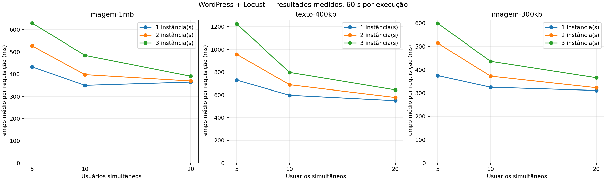
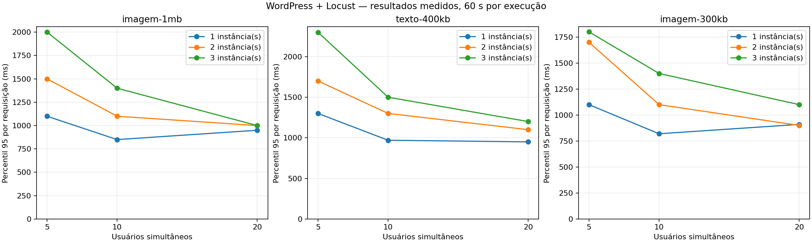
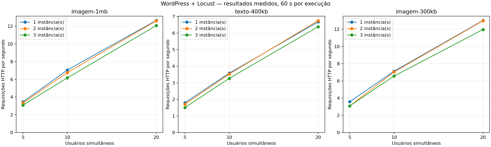
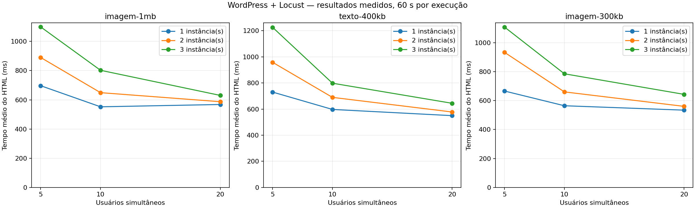
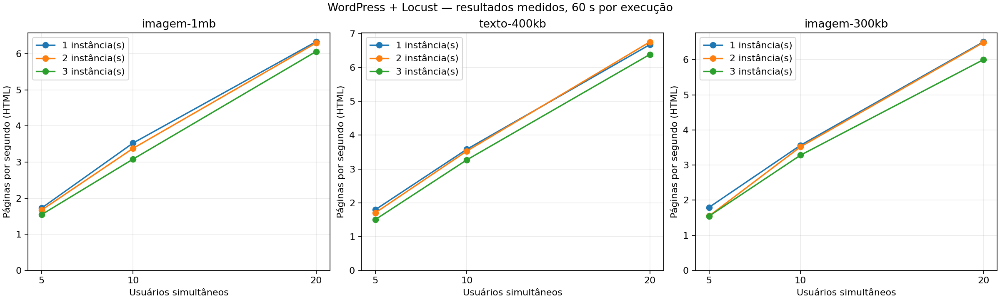

# Trabalho 3 — WordPress e Locust

Requisitos conferidos no PDF "Trabalho 3 – Realização de Testes de Carga com Múltiplas Instâncias do Wordpress Utilizando o Locust": três conteúdos, três cargas crescentes, três quantidades de instâncias e gráficos com usuários/instâncias no eixo X e métricas no eixo Y.

Estado: matriz completa (27/27). Dados reais; nenhuma interpolação ou resultado inventado.

## Conteúdos e execução

- Imagem ~1 MB: post 6; PNG original com 1.046.039 bytes.
- Texto ~400 KB: post 7; texto sintético de 409.600 bytes (400 KiB), além do HTML do tema.
- Imagem ~300 KB: post 9; PNG original com 307.963 bytes.
- 1, 2 e 3 contêineres WordPress ativos; upstreams do Nginx conferidos antes de cada topologia.
- 5, 10 e 20 usuários; subida de 1 usuário/s; duração de 60 s incluindo a subida; espera aleatória de 1–3 s após cada visita.
- Uma execução por combinação; testes sequenciais no mesmo computador, com banco e arquivos compartilhados. Gerador e aplicação disputam recursos locais.
- Cada visita solicita o HTML e, nos posts de imagem, baixa o PNG original por HTTP. Sem cache de navegador; não carrega CSS, JavaScript, outras imagens do tema ou srcset.
- O Locust usa http://nginx com Host localhost:8080; redirecionamentos são considerados falhas. Valida marcador do post e hash/tamanho da imagem.
- RPS agregado conta HTML + imagem; páginas/s conta somente HTML. A média agregada mistura recursos diferentes; compare cenários também pelo gráfico de HTML.
- Percentis extraídos dos CSVs do Locust; valores arredondados pelo próprio Locust. Requisições que terminam durante a drenagem podem estender a janela registrada.
- Há pré-aquecimento funcional por topologia, mas nenhuma janela de estabilização excluída das estatísticas. Ordem fixa: instâncias crescentes, depois cenário e usuários crescentes. Aquecimento e caches podem confundir comparações. Não há repetições para estimar variância ou intervalos de confiança.
- Os números 10/100/1000 do PDF são exemplos. As cargas 5/10/20 foram escolhidas pelo usuário para limitar o impacto local; estes resultados não estimam capacidade máxima.

## Resultados

|Post|Instâncias|Usuários|Requisições|Falhas|Média HTTP (ms)|p95 (ms)|HTTP/s|HTML (ms)|Páginas/s|
|---|---:|---:|---:|---:|---:|---:|---:|---:|---:|
|imagem-1mb|1|5|198|0|433.2|1100|3.45|696.5|1.73|
|imagem-1mb|1|10|414|0|349.7|850|7.05|552.1|3.53|
|imagem-1mb|1|20|741|0|364.4|950|12.65|568.0|6.33|
|imagem-1mb|2|5|192|0|528.0|1500|3.34|889.8|1.67|
|imagem-1mb|2|10|394|0|398.0|1100|6.76|649.1|3.38|
|imagem-1mb|2|20|740|0|369.4|1000|12.60|587.1|6.30|
|imagem-1mb|3|5|184|0|630.2|2000|3.09|1099.1|1.54|
|imagem-1mb|3|10|366|0|485.0|1400|6.16|802.1|3.08|
|imagem-1mb|3|20|711|0|390.9|1000|12.07|630.2|6.06|
|imagem-300kb|1|5|213|0|375.2|1100|3.57|666.2|1.79|
|imagem-300kb|1|10|414|0|325.3|820|7.13|564.6|3.56|
|imagem-300kb|1|20|764|0|311.5|910|13.02|534.2|6.51|
|imagem-300kb|2|5|187|0|514.6|1700|3.08|933.5|1.55|
|imagem-300kb|2|10|412|0|372.7|1100|7.04|660.3|3.52|
|imagem-300kb|2|20|762|0|323.2|900|12.98|560.3|6.49|
|imagem-300kb|3|5|180|0|599.3|1800|3.09|1108.1|1.54|
|imagem-300kb|3|10|384|0|436.5|1400|6.56|785.4|3.28|
|imagem-300kb|3|20|704|0|366.1|1100|11.97|643.3|6.00|
|texto-400kb|1|5|105|0|730.3|1300|1.79|730.3|1.79|
|texto-400kb|1|10|207|0|597.4|970|3.58|597.4|3.58|
|texto-400kb|1|20|392|0|549.8|950|6.68|549.8|6.68|
|texto-400kb|2|5|101|0|958.3|1700|1.70|958.3|1.70|
|texto-400kb|2|10|207|0|689.8|1300|3.53|689.8|3.53|
|texto-400kb|2|20|390|0|577.8|1100|6.76|577.8|6.76|
|texto-400kb|3|5|89|0|1226.0|2300|1.50|1226.0|1.50|
|texto-400kb|3|10|195|0|798.2|1500|3.27|798.2|3.27|
|texto-400kb|3|20|375|0|644.4|1200|6.39|644.4|6.39|

## Gráficos

## Leitura dos resultados

- imagem-1mb, 20 usuários: de 1 para 3 instâncias, páginas/s passaram de 6.33 para 6.06; a média do HTML passou de 568.0 para 630.2 ms. Esta é uma comparação observada nesta execução, sem estimativa de incerteza.
- texto-400kb, 20 usuários: de 1 para 3 instâncias, páginas/s passaram de 6.68 para 6.39; a média do HTML passou de 549.8 para 644.4 ms. Esta é uma comparação observada nesta execução, sem estimativa de incerteza.
- imagem-300kb, 20 usuários: de 1 para 3 instâncias, páginas/s passaram de 6.51 para 6.00; a média do HTML passou de 534.2 para 643.3 ms. Esta é uma comparação observada nesta execução, sem estimativa de incerteza.

Total medido: 10,021 requisições HTTP e 0 falhas nas 27 combinações disponíveis.

## Evidências e limites

Cada pasta de execução contém CSVs originais, relatório HTML do Locust, console, parâmetros e amostras de recursos Docker. environment.json registra o ambiente; topology-*.json registra os upstreams observados. O arquivo COMPLETE existe somente após todas as execuções.

Os resultados permitem comparar este ambiente e esta janela de carga. Não demonstram escalabilidade em máquinas independentes: MySQL, volume de arquivos e recursos do computador são compartilhados. Uma única amostra curta por ponto está sujeita a aquecimento, caches e variação do host.

## Alterações e reprodução

Scripts em scripts/trabalho3; execute a partir do projeto: python scripts/trabalho3/run_matrix.py. Requer Python; para gerar os gráficos: python scripts/trabalho3/report.py (matplotlib). O Locust vem da imagem já usada no Compose. O script de preparação não deve ser repetido sem revisão: recusa slugs de teste existentes.

Foram acrescentados três posts e duas mídias; locust/locustfile.py foi substituído e locust/posts.json guarda IDs, URLs e hashes sem credenciais. Compose foi preservado. O Nginx muda temporariamente durante a matriz e é restaurado no bloco finally; WordPress 1/2/3 voltam a funcionar ao final.

Backup anterior de banco/configuração guardado privadamente na pasta work/private desta conversa, fora do repositório. Não inclua o backup SQL, .env ou wp-config.php em commits. Nenhum commit ou envio remoto foi executado.

Commit sugerido: `feat: adiciona cenarios Locust e resultados do Trabalho 3`.

Revisar antes do commit: `git diff -- docker-compose.yml locust/locustfile.py README.md .gitignore` e `git status --short`. Incluir somente locust/locustfile.py, locust/posts.json, scripts/trabalho3, docs/trabalho3 e documentação revisada. A alteração pré-existente do Compose deve ser revisada separadamente.

## Verificação final

CPUs=16; MemTotal=7986298880; Docker=29.5.3; OS=Docker Desktop; Arch=x86_64

As 27 combinações atingiram o número previsto de usuários (conferido no histórico Locust). Os arquivos Compose e Nginx coincidem byte a byte com o backup anterior; os seis serviços voltaram a funcionar, o post original 1 responde HTTP 200 e a interface Locust foi reiniciada com o script novo.
